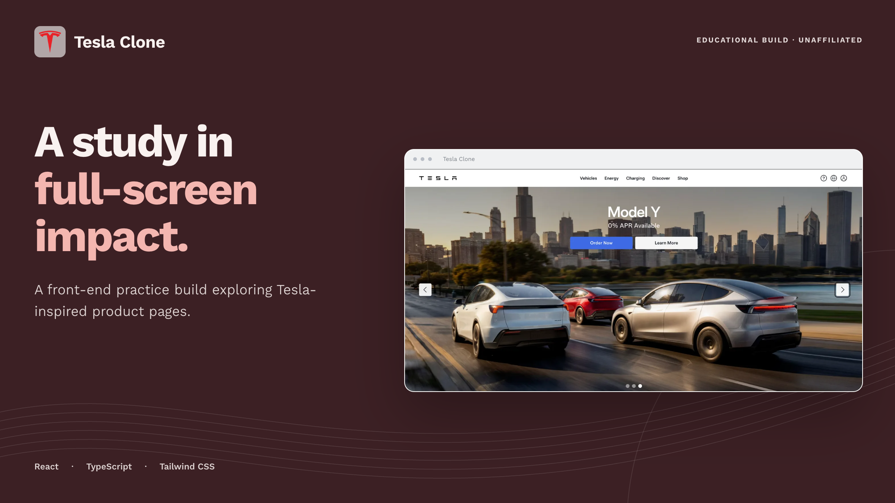
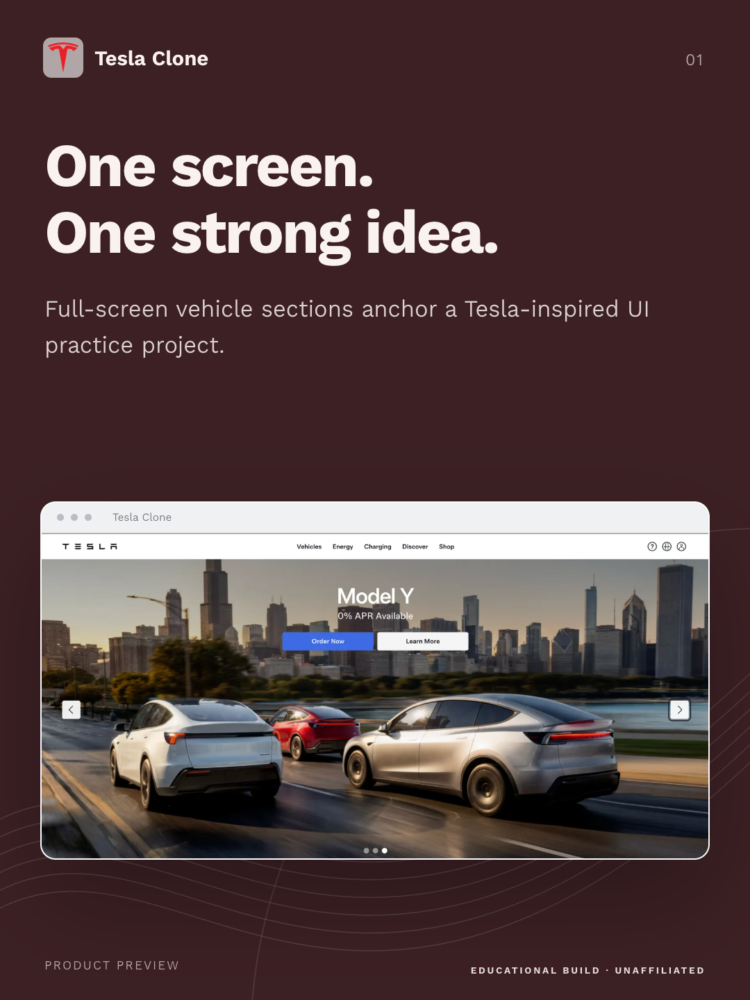
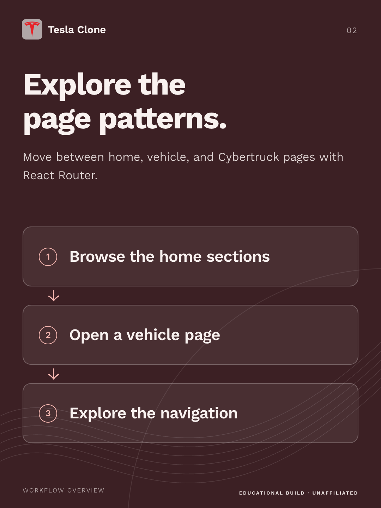
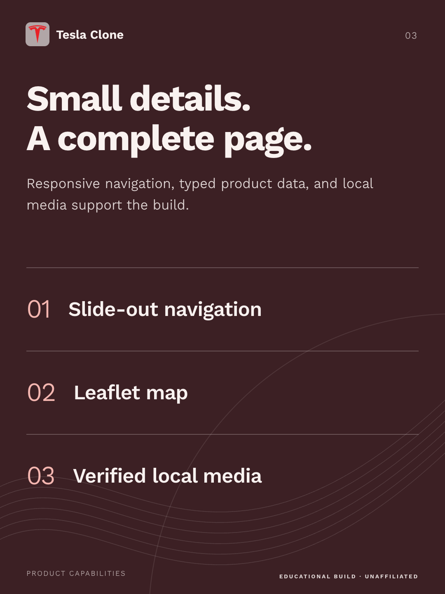

# React Tesla Clone

A Tesla-inspired product site built with React, TypeScript, React Router, and
Tailwind CSS.

<!-- product-images:start -->

## Product preview

<p align="center">
  
</p>

<table>
<tr>
  <td width="33%"></td>
  <td width="33%"></td>
  <td width="33%"></td>
</tr>
</table>

<!-- product-images:end -->

## Development

```bash
npm install
npm start
```

The development server uses port `3000` when it is available.

## Quality checks

```bash
npm run typecheck
npm run lint
npm run format:check
npm run build
```

Use `npm run format` to apply Prettier formatting.

## Project structure

The source layout follows the feature-oriented conventions used by
`apsaratalent-web` while remaining compatible with Create React App:

```text
src/
├── app/                 # Route-level pages and router composition
│   ├── cybertruck/
│   ├── home/
│   └── vehicles/
├── components/          # Reusable components grouped by feature
│   ├── home/
│   └── navbar/
├── data/                # Typed static product and navigation data
├── utils/
│   └── types/           # Shared TypeScript domain models
├── index.css
└── index.tsx            # Browser entry point
```

Component folders use kebab-case names and expose an `index.tsx`; reusable
component contracts live in adjacent `props.ts` files.
